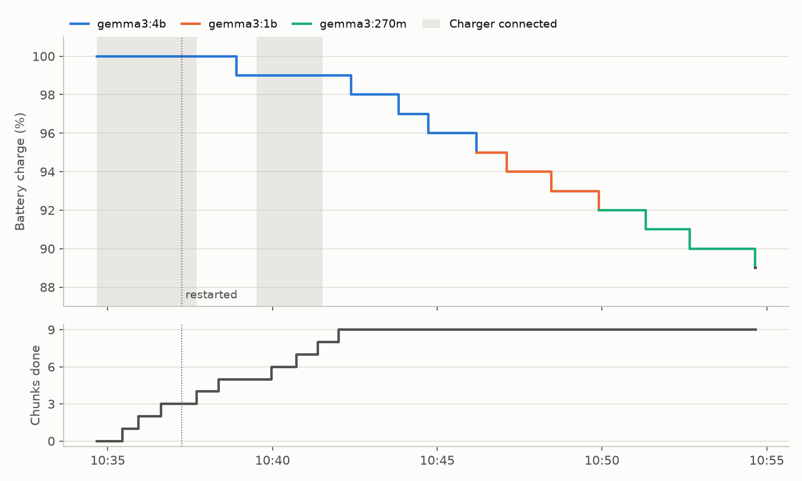

# Sunspot Node: proof of concept

An energy-aware AI runtime, tested on a laptop battery before any solar hardware is bought.

Sunspot Node is a proposal for small, solar-powered AI compute nodes that keep working when the power doesn't. The node's battery decides what it runs: as charge falls, it steps down to smaller models instead of switching off, it runs deferrable batch work only when there is surplus energy, and it never loses finished work when the power goes.

This repository tests that logic on an ordinary laptop. The laptop battery stands in for the node's LiFePO4 battery, and the charger stands in for solar surplus. The proof-of-concept document is in [docs/sunspot-poc.pdf](docs/sunspot-poc.pdf), and this README gives the steps to reproduce its results.

## Result

The demonstration ran on 27 October 2026. All five steps behaved as expected and all five pass criteria were met.



*Battery charge during the demonstration, coloured by the model in use. Shaded areas are when the charger was connected. The dotted line marks the restart after the process was killed in the middle of a chunk. The lower panel shows finished batch chunks.*

| Model | Speed (tokens/s) | Average draw on battery (W) | Time in band |
|---|--:|--:|--:|
| Gemma 3 4B | 7.4 | 24.8 | 4.1 min |
| Gemma 3 1B | 17.8 | 23.4 | 3.6 min |
| Gemma 3 270M | 62.3 | 18.6 | 4.6 min |

From the final stretch on battery, 99% to 89% in 12.7 minutes. Speed is the mean of 6, 6 and 8 test prompts. Draw is the laptop's own discharge reading, averaged by its firmware, for the whole laptop including the screen. It is not a metered figure.

The log, the finished chunks and the chart are in [results/test-a](results/test-a).

## What it tests

1. **Battery ladder.** As charge falls, the runtime unloads the larger model and loads a smaller one.
2. **Surplus window.** A batch job (summarising a public-domain book, one chunk at a time) runs only while the charger is connected and the battery is nearly full. It pauses when the charger is pulled and resumes when it is reconnected.
3. **Safe stops.** Each finished chunk is written to a temporary file, flushed to disk and renamed, so an abrupt stop leaves either the whole result or none of it. On restart, the runtime skips finished work. At the reserve level it unloads the model and exits.

It does not show solar generation, forecasting, a LiFePO4 battery, the full node's hardware, the pool of nodes, or setup by people without a systems background. The laptop's power readings come from its firmware and do not replace a meter.

## Requirements

- A laptop with a battery.
- Python 3.9 or later.
- [Ollama](https://ollama.com), running locally.
- About 4.5 GB of disk space for the three models.

The demonstration ran on Windows 11 Pro with an Intel Core i7-1185G7 (models running on the processor), 16 GB of memory and a 42.8 Wh battery, using Python 3.13.13 and Ollama 0.40.5. The code reads power draw on Windows and Linux, and leaves that column empty on other systems. It has only been tested on Windows.

## Setup

Clone or download this repository, and open a terminal in its folder.

Create a virtual environment and install the two dependencies, psutil (battery readings) and matplotlib (the chart):

```powershell
# Windows PowerShell
python -m venv .venv
.venv\Scripts\Activate.ps1
pip install -r requirements.txt
```

```bash
# Linux or macOS
python3 -m venv .venv
source .venv/bin/activate
pip install -r requirements.txt
```

If PowerShell refuses to run `Activate.ps1`, run `Set-ExecutionPolicy -Scope Process Bypass` in the same window and try again.

Pull the three models:

```
ollama pull gemma3:4b
ollama pull gemma3:1b
ollama pull gemma3:270m
```

Download the book used as the batch job, *Pride and Prejudice* from Project Gutenberg:

```
mkdir data
python -c "import urllib.request; urllib.request.urlretrieve('https://www.gutenberg.org/cache/epub/1342/pg1342.txt', 'data/book.txt')"
```

The file used on 27 October 2026 had the SHA-256 hash `3f6bb9d6f78e0293b56acd4714dd68cb7d6d1d293402031ce9d5a216bcaf9d75` and split into 272 chunks. Any long plain-text file works, but the chunk counts below will differ.

## Reproduce the demonstration

The demonstration narrows the bands so every step happens within about 20 minutes: 4B at 96% and above, 1B from 93%, 270M from 90%, and reserve below 90%. The batch job runs from 97%, and a test prompt goes out every 30 seconds.

### Before you start

- Charge the laptop to 100% and leave the charger connected.
- Make sure Ollama is running (open the Ollama app, or run `ollama serve`).
- Stop the laptop from sleeping on battery for the length of the test, and keep the screen on. A laptop that sleeps halfway through will stall the run.
- Delete any `sunspot-run` folder left from an earlier run, so the run starts from chunk zero.
- Some laptops stop charging at 80% or another limit to protect the battery. If yours does, turn the limit off for the test, or the batch job will never start.

### Run it

```
python sunspot_poc.py run --input data/book.txt --floors 96,93,90 --surplus 97 --probe-every 30 --tick 5
```

Each event prints as one line: time, charge, charger state, model, event and progress. The same rows go to `sunspot-run/log.csv`.

| Step | What you do | What you should see |
|---|---|---|
| 1 | Start the command above with the charger connected. | `switch` to `gemma3:4b`, `batch running`, then a `chunk done` line for each chunk. On the test laptop each chunk took about 30 seconds. |
| 2 | After three chunks are done, wait for the next `probe` line. The next chunk starts straight after it, so end the process abruptly about halfway through that chunk (15 seconds on the test laptop) from a second terminal (commands below). Then start the same command again. | On restart, `start: 269 of 272 chunks left` if three chunks were done. The half-finished chunk is redone from the beginning. No `.tmp` file is left in `sunspot-run/out`. |
| 3 | After another chunk is done, wait for the next `probe` line and pull the charger a few seconds later, while the next chunk is running. | The running chunk finishes (`chunk done`), then `batch paused`. `probe` lines carry on every 30 seconds. |
| 4 | Reconnect the charger. | `batch running` at the next power check, and chunks carry on. If the charge has fallen below 97%, the batch job waits until the battery charges back to 97%. |
| 5 | After three or four more chunks, pull the charger and leave the laptop running. | The running chunk finishes and the batch job pauses. Then `switch` to `gemma3:1b` once the charge reads below 96%, `switch` to `gemma3:270m` below 93%, and `reserve: model unloaded` and `shutdown: finished work is on disk` below 90%. The program exits on its own. On the test laptop this took 12.7 minutes. |

To end the process abruptly in step 2, use one of these from a second terminal. Ctrl+C stops the runtime cleanly and logs `stopped by user`, so it does not test an abrupt stop.

```powershell
# Windows PowerShell
Get-CimInstance Win32_Process -Filter "Name='python.exe'" | Where-Object { $_.CommandLine -like '*sunspot_poc*' } | ForEach-Object { Stop-Process -Id $_.ProcessId -Force }
```

```bash
# Linux or macOS
pkill -9 -f sunspot_poc.py
```

### Check the result

```
python sunspot_poc.py plot
```

This prints a summary and writes the chart to `sunspot-run/ladder.png`. For the 27 October 2026 run it printed:

```
On battery from 2026-10-27 10:42:01 to 10:54:40: 99% to 89% in 12.7 min

Model          Probes   Tok/s  Watts*  Minutes
gemma3:4b           6     7.4    24.8      4.1
gemma3:1b           6    17.8    23.4      3.6
gemma3:270m         8    62.3    18.6      4.6
* average laptop draw while this model was in use, as the firmware reports it

Chunks on disk: 9 (log says 9), numbered in order: yes, empty: 0, temporary files: 0, errors logged: 0
```

Speeds and power draw depend on the laptop, and the number of chunks depends on when you pull the charger. The run passes if:

| Check | Pass if |
|---|---|
| Ladder steps | All three `switch` or `reserve` events happen at the first power check after the charge falls below each band. |
| Surplus window | Each time the charger is pulled, `batch paused` follows the running chunk's `chunk done`. Each time it is reconnected at 97% or above, `batch running` follows at the next check. |
| Abrupt stops | The summary shows chunks on disk equal to the logged count, numbered in order, none empty, no temporary files. |
| Reserve | The log ends with `reserve: model unloaded` and `shutdown: finished work is on disk`. |
| Measurements | The summary gives speed and average draw for each model. No target is set. |

### Check the published results without running the test

The summary and chart can be rebuilt from the published log alone. This needs neither Ollama nor a battery:

```
python sunspot_poc.py plot --workdir results/test-a
```

It prints the summary above and redraws `results/test-a/ladder.png`.

## Next step: a full drain

The next test is a full drain with the default bands: 4B at 65% and above, 1B from 35%, 270M from 15%, and reserve below 15%. It gives speed and power draw for each model over a run of hours rather than minutes. Charge the laptop to 100%, pull the charger, start the runtime and leave it until it exits:

```
python sunspot_poc.py run --input data/book.txt
python sunspot_poc.py plot
```

## Options

| Option | Default | Meaning |
|---|---|---|
| `--input` | required | Long plain-text file for the batch job. |
| `--models` | `gemma3:4b,gemma3:1b,gemma3:270m` | Ladder models, largest first. With a capable GPU, a larger ladder such as `gemma3:12b,gemma3:4b,gemma3:1b` works too. |
| `--floors` | `65,35,15` | Lowest charge (%) for each model, matching `--models`. Below the last floor is reserve. |
| `--surplus` | `90` | The batch job runs only when the charger is connected and the charge is at or above this level. |
| `--tick` | `10` | Seconds between power checks. |
| `--probe-every` | `300` | Seconds between test prompts that measure speed. |
| `--workdir` | `sunspot-run` | Folder for the log, the finished chunks and the chart. `plot` takes it too. |

## How it works

`sunspot_poc.py` sits between the laptop's battery and Ollama. On each pass of its loop it:

1. Reads the charge level and whether the charger is connected, through psutil.
2. Picks the model for that charge band, unloading the previous one to free memory.
3. Below the last floor, unloads the model and exits if the charger is disconnected.
4. Starts or pauses the batch job depending on whether it is in the surplus window.
5. Sends a short test prompt when one is due and records its speed.
6. Runs the next batch chunk if the job is running, writes the result atomically, and checks power again before the next one.

Every event goes to `log.csv` with the time, charge, charger state, power draw, model, event, chunks done and speed. Power draw comes from `BatteryStatus.DischargeRate` on Windows, which reads 0 while the charger is connected, and from `/sys/class/power_supply/BAT*/power_now` on Linux. If Ollama stops responding, the runtime logs the error, waits one tick and tries again.

## Files

| Path | Contents |
|---|---|
| `sunspot_poc.py` | The runtime (`run`) and the summary and chart (`plot`). |
| `requirements.txt` | psutil and matplotlib, at the versions tested. |
| `results/test-a/` | Log, finished chunks and chart from the 27 October 2026 demonstration. |
| `docs/sunspot-poc.html` | The proof-of-concept document. `docs/sunspot-poc.pdf` is the printable copy. |
| `LICENSE` | Apache License 2.0. |

## Licence

The code is released under the Apache License 2.0 (see [LICENSE](LICENSE)). The log, finished chunks and chart in `results/` and the document in `docs/` are released under [CC BY 4.0](https://creativecommons.org/licenses/by/4.0/).

The book is not included. *Pride and Prejudice* is downloaded from [Project Gutenberg](https://www.gutenberg.org/ebooks/1342) under the Project Gutenberg License.
